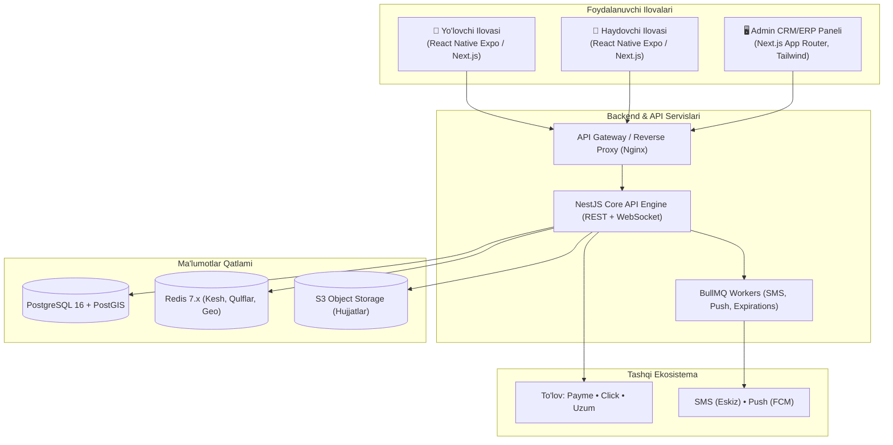

# OTAXI — Intercity & Cross-Border Ridesharing Platform for Central Asia

[](https://nodejs.org/)
[](https://pnpm.io/)
[](https://www.typescriptlang.org/)
[](https://turbo.build/)
[](https://nextjs.org/)
[](https://nestjs.com/)
[](https://www.postgresql.org/)
[](https://redis.io/)

**OTAXI** — Markaziy Osiyo mamlakatlari (O'zbekiston, Qozog'iston, Qirg'iziston) o'rtasida shaharlararo va xalqaro safarlarni tekshirilgan haydovchilar bilan bron qilish, to'lash va xavfsiz amalga oshirish uchun mo'ljallangan yagona mobility ekotizimi.

---

## 🏛️ Tizim Arxitekturasi

Platforma yuqori yuklamalarga chidamli **Turborepo** monorepo strukturasiga asoslangan:



---

## 📁 Loyiha Strukturasi

```text
otaxi/
├── apps/
│   ├── backend/         # NestJS Core API (Prisma, PostgreSQL, Redis, Socket.IO, BullMQ)
│   ├── web-admin/       # Next.js App Router (CRM & ERP Paneli, Haydovchi moderatsiyasi, Audit)
│   ├── web-passenger/   # Yo'lovchi veb ilovasi
│   ├── web-driver/      # Haydovchi veb ilovasi
│   └── mobile/          # React Native Expo mobil ilovasi (iOS va Android)
├── packages/
│   ├── config/          # Umumiy TypeScript va ESLint konfiguratsiyalari
│   ├── types/           # Umumiy TypeScript interfeyslari, DTO va Enumlar (@otaxi/types)
│   └── ui/              # Reusable UI komponentlar kutubxonasi (@otaxi/ui)
├── docs/
│   ├── PRD.md           # Mahsulotning to'liq talablari hujjati (PRD / TZ)
│   ├── ARCHITECTURE.md  # Tizim arxitekturasi, ma'lumotlar oqimi va xavfsizlik
│   └── API_SPEC.md      # REST API va WebSocket eventlari xaritasi
├── docker-compose.yml   # PostgreSQL (PostGIS) va Redis xizmatlari
├── turbo.json           # Turborepo kesh va task quvurlari
└── package.json         # Root monorepo boshqaruvi (pnpm workspaces)
```

---

## 🚀 Tezkor Boshlash (Quick Start)

### 1. Talablar
- **Node.js** `>= 18.0.0` (tavsiya etiladi: `20.x` yoki `22.x`)
- **pnpm** `>= 9.0.0` (`corepack enable && corepack prepare pnpm@latest --activate`)
- **Docker** va **Docker Compose**

### 2. O'rnatish
```bash
# Repozitoriyani klonlash
git clone https://github.com/thefarrukhdev/otaxi.git
cd otaxi

# Bog'liqliklarni o'rnatish
pnpm install
```

### 3. Konfiguratsiya (.env)
```bash
# Namuna konfiguratsiyadan nusxa olish
cp .env.example .env
```

### 4. Ma'lumotlar Bazasi va Keshni Ishga Tushirish
```bash
# PostgreSQL (PostGIS) va Redis konteynerlarini fonda ishga tushirish
pnpm docker:up

# Prisma jadvallarini generatsiya qilish va migratsiyalarni yurgizish
pnpm --filter @otaxi/backend prisma:generate
pnpm --filter @otaxi/backend prisma:migrate

# Dastlabki test ma'lumotlarini bazaga yuklash (Seed)
pnpm backend:seed
```

### 5. Dasturni Ishga Tushirish (Development Mode)
```bash
# Barcha ilovalarni parallel rejimda ishga tushirish
pnpm dev

# Yoki alohida ilovalarni ishga tushirish:
pnpm dev:admin       # Admin CRM & ERP Paneli: http://localhost:3003
pnpm dev:backend     # NestJS Backend API:     http://localhost:3000/api/v1
pnpm dev:passenger   # Yo'lovchi ilovasi:      http://localhost:3001
pnpm dev:driver      # Haydovchi ilovasi:      http://localhost:3002
```

---

## 🛠️ Mavjud Buyruqlar (Scripts)

| Buyruq | Tavsif |
|---|---|
| `pnpm build` | Turborepo yordamida barcha loyihalarni production uchun kompilyatsiya qilish |
| `pnpm dev` | Barcha ilovalarni hot-reload rejimida ishga tushirish |
| `pnpm typecheck` | Monorepo bo'ylab barcha TypeScript turlarini tekshirish (`tsc --noEmit`) |
| `pnpm lint` | Kod uslubi va statik tahlil tekshiruvini yurgizish |
| `pnpm format` | Prettier orqali barcha fayllarni formatlash |
| `pnpm docker:up` | PostgreSQL va Redis konteynerlarini ishga tushirish |
| `pnpm docker:down` | Konteynerlarni to'xtatish |
| `pnpm backend:seed` | Boshlang'ich haydovchilar, reyslar va chek-listlarni bazaga yuklash |

---

## 🔒 Xavfsizlik va Maxfiylik

- **Zero Secrets in Code:** Hech qanday kalitlar, ma'lumotlar bazasi URL manzillari kodga yozilmaydi; barchasi faqat `.env` orqali beriladi.
- **Audit Logging:** Barcha ma'muriy operatsiyalar (moderatsiya, pul qaytarish, tariflar o'zgarishi) o'zgartirib bo'lmas `AuditLog` ga yoziladi.
- **O'zbekiston Qonunchiligi:** O'zbekiston Respublikasi O'RQ-547 qonuniga muvofiq shaxsiy ma'lumotlar O'zbekiston hududidagi serverlarda saqlanadi.

---

## 📚 Hujjatlar
- 📖 [Mahsulot Talablari Hujjati (PRD)](docs/PRD.md)
- 🏗️ [Tizim Arxitekturasi (ARCHITECTURE)](docs/ARCHITECTURE.md)
- 🔌 [API va WebSocket Spesifikatsiyasi (API_SPEC)](docs/API_SPEC.md)

---

## 📄 Litsenziya
Ushbu loyiha xususiy mulk hisoblanadi. Barcha huquqlar himoyalangan © 2026 OTAXI.
