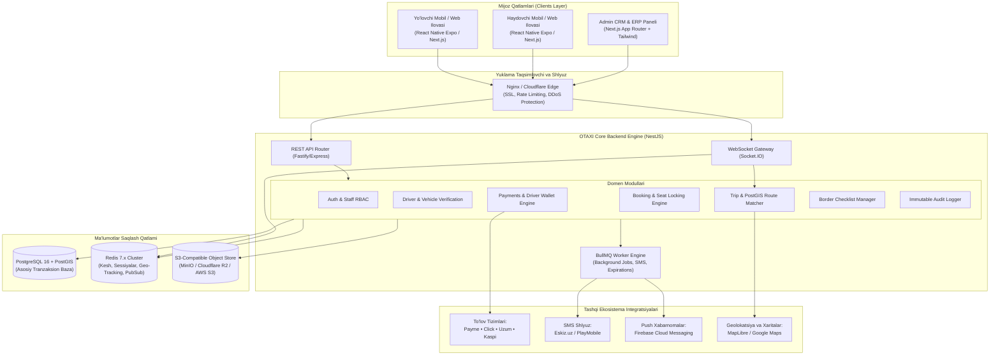
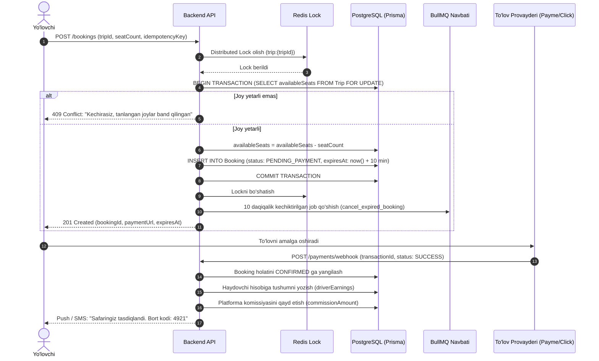
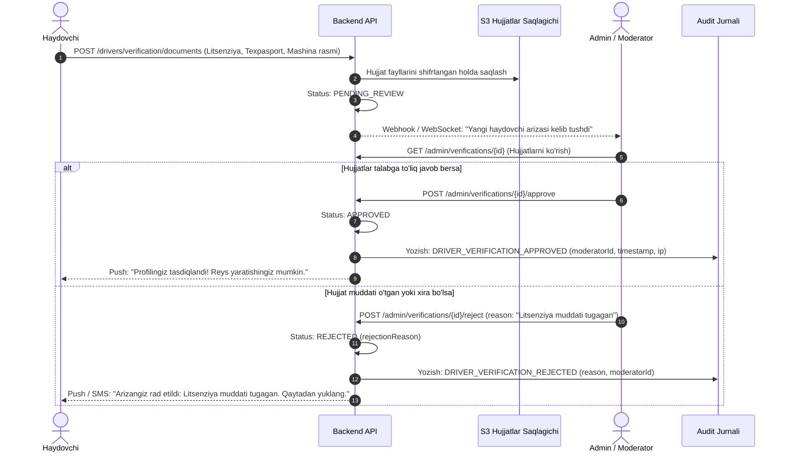

# OTAXI Platform — Tizim Arxitekturasi va Muhandislik Qo'llanmasi (Architecture Manifesto)

| Maydon | Qiymat |
|---|---|
| Hujjat | OTAXI Enterprise Architecture Specification |
| Versiya | 1.0.0 (Production-Ready) |
| Sana | 2026-10-27 |
| Muallif | OTAXI Senior Platform & DevOps Muhandislik Jamoasi |
| Holat | Tasdiqlangan va amaliyotga joriy etilgan |

---

## 1. Kirish va Arxitektura Prinsiplari

**OTAXI** — Markaziy Osiyo (O'zbekiston, Qozog'iston, Qirg'iziston, Tojikiston) bo'ylab shaharlararo va xalqaro safarlarni xavfsiz, qulay va rejalashtirilgan tarzda amalga oshirishga mo'ljallangan yuqori yuklamali (high-concurrency) mobility marketplace platformasidir.

### Asosiy Muhandislik Prinsiplari:
1. **Modulli Monolitdan Xizmatlarga (Modular Monolith First):** Boshlang'ich bosqichda haddan tashqari tarqoq mikroservislar hosil qilmasdan, qat'iy domen chegaralariga (Domain-Driven Design) ega modulli NestJS arxitekturasi qo'llaniladi. Bu tranzaksiyalar yaxlitligini ta'minlaydi va keyinchalik mikroservislarga ajratishni osonlashtiradi.
2. **Tranzaksion Ishonchlilik va Idempotentlik:** Barcha moliyaviy amallar (to'lovlar, komissiya hisoblash, qaytarishlar/refund) va joy bron qilish operatsiyalari pessimistik qulflash (`SELECT FOR UPDATE`) va `idempotencyKey` mexanizmlari bilan race condition xavfidan himoyalangan.
3. **Chegara va Me'yoriy Muvofiqlik (Compliance by Design):** Xalqaro qatnovlarda mamlakatlararo qonuniy talablar (viza, biometrik pasport, avtosug'urta, bojxona deklaratsiyasi) platformaning yadrosiga chek-listlar ko'rinishida singdirilgan.
4. **Nol Ishonch Xavfsizligi (Zero-Trust & RBAC):** Har bir so'rov JWT bearer token orqali tekshiriladi; ma'muriy operatsiyalar qat'iy rollarga bo'lingan va o'zgartirib bo'lmaydigan audit jurnaliga (`AuditLog`) qayd etiladi.
5. **Yuqori Unumdorlik va Kesh:** Tez-tez so'raladigan qidiruv natijalari va geografik marshrutlar Redis keshida saqlanadi, og'ir vazifalar (SMS, Push, to'lov muddatini nazorat qilish) BullMQ navbatlarida asinxron bajariladi.

---

## 2. Umumiy Tizim Topologiyasi

Quyidagi diagrammada OTAXI tizimining foydalanuvchi interfeyslari, backend xizmatlari, ma'lumotlar bazalari va tashqi integratsiyalari o'rtasidagi o'zaro bog'liqlik ko'rsatilgan:

---

## 3. Asosiy Ma'lumotlar Oqimlari va Tranzaksiyalar

### 3.1 Joy Bron Qilish va Race-Condition Himoyasi (Booking & Seat Lock)

Ikki yo'lovchi bir vaqtda so'nggi bo'sh joyni bron qilib qo'yishining oldini olish uchun bazada qat'iy tranzaksion izolyatsiya va vaqtincha bron (Temporary Reservation) holati qo'llaniladi:

---

### 3.2 Haydovchi Hujjatlarini Tekshirish va Moderatsiya Oqimi

---

## 4. Xavfsizlik, Maxfiylik va Huquqiy Muvofiqlik

1. **Maxfiy Ma'lumotlar Himoyasi:**
   - Hech qanday API kalitlar, ma'lumotlar bazasi parollari yoki JWT sirlari git repozitoriyasiga kiritilmaydi. Barcha sirlar faqat `.env` va xavfsiz CI/CD Secret Store orqali inyeksiyalanadi.
   - Foydalanuvchilarning telefon raqamlari va shaxsiy hujjatlari saqlashda AES-256 shifrlash bilan himoyalanadi.
2. **Qonuniy Muvofiqlik (O'zbekiston Respublikasi "Shaxsiy ma'lumotlar to'g'risida"gi O'RQ-547 qonuni):**
   - O'zbekiston fuqarolarining shaxsiy ma'lumotlar bazasi jismoniy jihatdan O'zbekiston hududida joylashgan serverlarda saqlanadi.
   - Xalqaro safarlarda faqat yo'lovchi o'zi ruxsat bergan chegaradan o'tish ma'lumotlari qayta ishlanadi.
3. **Audit va O'zgarmaslik (Immutable Audit Ledger):**
   - Barcha ma'muriy aralashuvlar (haydovchini tasdiqlash/bloklash, to'lovni qaytarish, komissiya tariflarini o'zgartirish, chegara talablarini yangilash) `AuditLog` jadvaliga xodimning ID si, IP-manzili, aniq `diff` obyekti va server vaqti bilan yoziladi.
   - Audit yozuvlarini o'chirish yoki tahrirlash dasturiy darajada qat'iyan taqiqlangan (`ON DELETE RESTRICT`).

---

## 5. Masshtablash va Yuqori Yuklama (Scalability & HA Strategy)

1. **Geografik Qidiruvlar Optimallashtirilishi:**
   - PostgreSQL `PostGIS` kengaytmasi orqali koordinatalar bo'yicha indeksatsiya (`GIST (geom)`).
   - Marshrut bo'yicha oraliq to'xtash joylarini (Waypoints) qidirishda spatial radius so'rovlari 50ms dan kam vaqt oladi.
2. **Ma'lumotlar Bazasi Ulanishlari:**
   - `PgBouncer` orqali connection pooling amalga oshiriladi (2000+ parallel ulanishlar uchun xotira tejash).
3. **Kesh Qatlamlari:**
   - Ommabop qidiruv yo'nalishlari (masalan, Toshkent ➔ Samarqand) Redisda 60 soniyalik TTL bilan keshlanadi.
   - Jonli GPS joylashuv koordinatalari to'g'ridan-to'g'ri Redis GEO (`GEOADD`, `GEORADIUS`) buyruqlari orqali ishlanadi va har 15 soniyada agregatsiya qilinadi.
4. **Konteynerlashtirish va CI/CD:**
   - Monorepo `turbo` bilan keshlanadi va Docker konteynerlariga joylashtiriladi.
   - GitHub Actions orqali avtomatik linter, tur tekshiruvi (typecheck), testlar va production deploy ta'minlanadi.

---

*Hujjat OTAXI texnik arxitektura kengashi tomonidan tasdiqlangan.*
