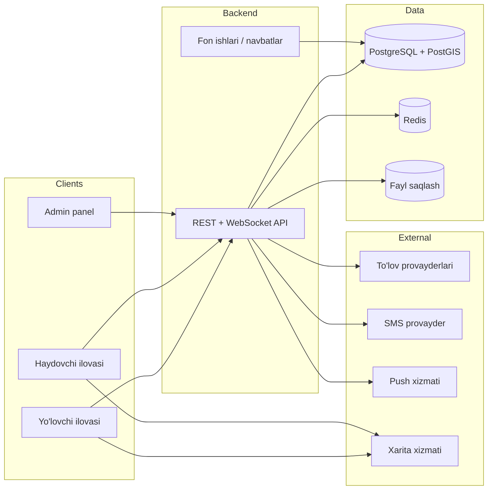
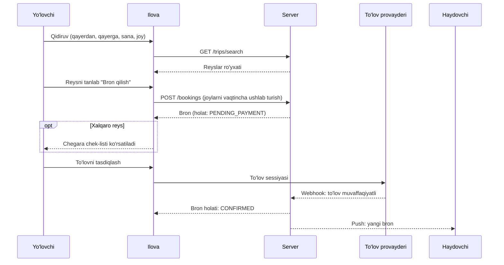
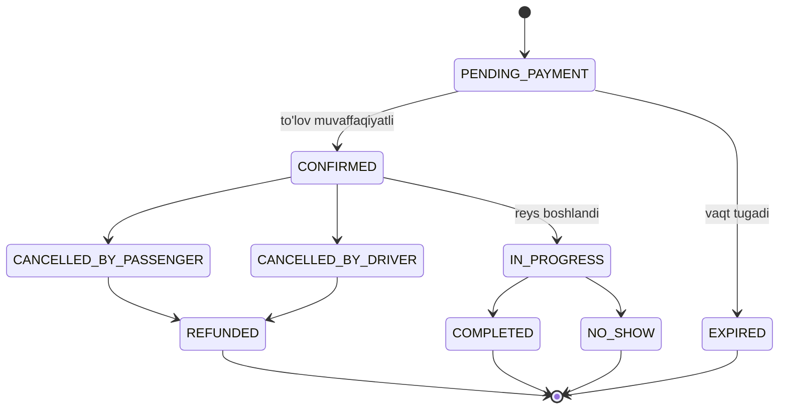
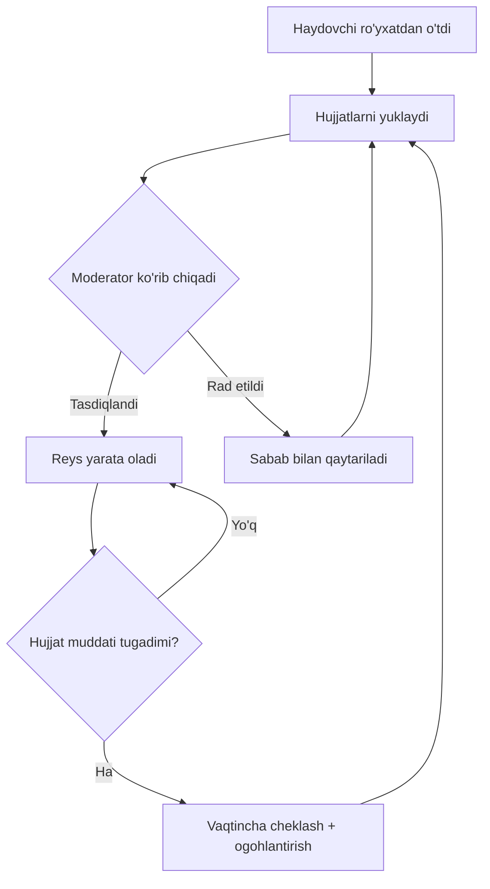
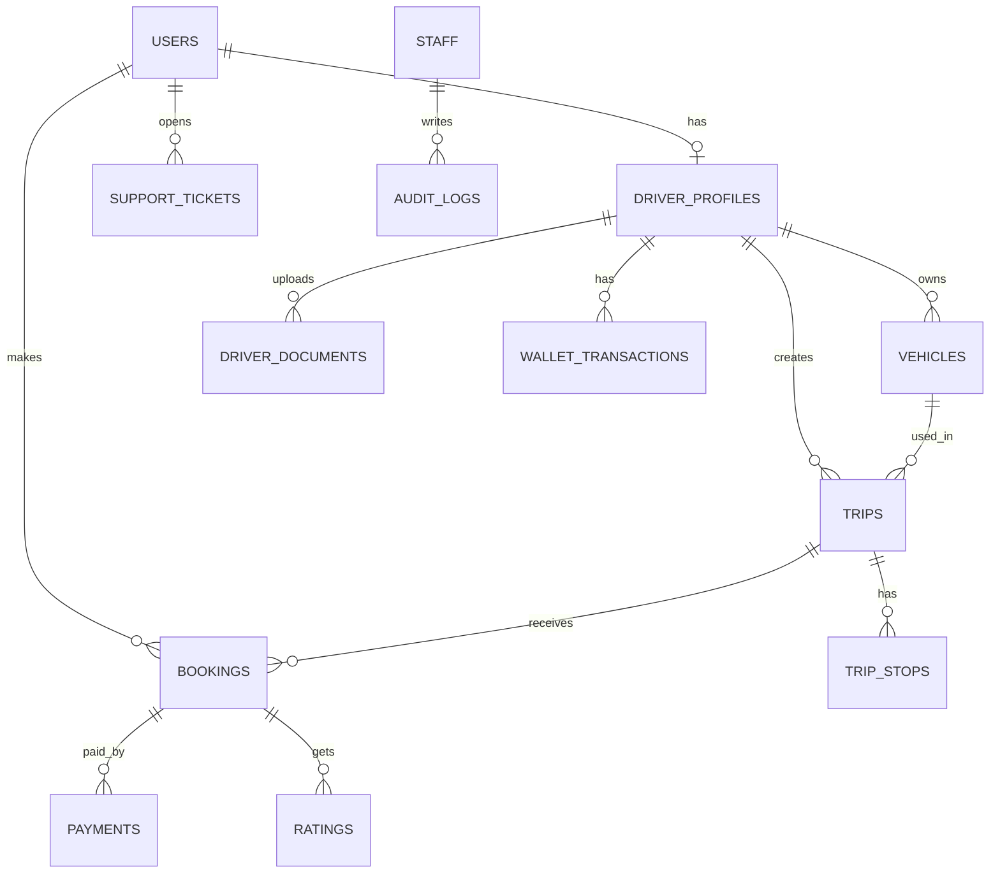

# OTAXI — Product Requirements Document (PRD / Texnik topshiriq)

| Maydon | Qiymat |
|---|---|
| Mahsulot | OTAXI — shaharlararo va xalqaro safarlar uchun bron platformasi |
| Hujjat versiyasi | 1.1 (Tasdiqlangan Arxitektura) |
| Sana | 2026-10-28 |
| Holat | Tasdiqlangan — ishlab chiqish bosqichida |
| Hujjat egasi | Product Owner (aniqlanadi) |
| Auditoriya | Founder, dasturchilar, dizaynerlar, QA, biznes tomon |

> **Eslatma.** Bu hujjat OTAXI demo-versiyasini (Yo'lovchi / Haydovchi / Admin panel) tahlil qilish va bozor qidiruvi asosida tuzilgan. Faktlarga asoslangan joylar "Bozor" bo'limida ko'rsatilgan; qolgan narsalar (biznes model, narxlar, muddatlar, qonuniy talablar) **taxmin yoki gipoteza** va ishga tushirishdan oldin tasdiqlanishi shart. Bunday joylar `[TASDIQLANSIN]` belgisi bilan ajratilgan.

---

## Mundarija

1. Qisqacha mazmun
2. Muammo va imkoniyat
3. Maqsadlar, KPI va maqsad emas narsalar
4. Bozor va raqobat
5. Foydalanuvchi rollari
6. Biznes model
7. Mahsulot qamrovi va modullar
8. Funksional talablar
9. Asosiy foydalanuvchi oqimlari
10. Nofunksional talablar
11. Tizim arxitekturasi va texnologiyalar
12. Ma'lumotlar modeli
13. API qamrovi
14. Integratsiyalar
15. Xavfsizlik, maxfiylik va qonuniy talablar
16. Ishga tushirish rejasi (roadmap)
17. Test strategiyasi va sifat mezonlari
18. Analitika va monitoring
19. Risklar va ularni kamaytirish
20. Ochiq savollar
21. Lug'at
22. Ilova: chegara chek-listi namunasi

---

## 1. Qisqacha mazmun

**OTAXI** — Markaziy Osiyo shaharlari va mamlakatlari o'rtasida (Uzbekiston, Qozog'iston, Qirg'iziston) tekshirilgan haydovchilar bilan **shaharlararo va xalqaro safarlarni** bron qilish platformasi.

Platforma quyidagi asosiy qismlardan iborat:

1. **Yagona Mobil Ilova (`apps/mobile` — React Native + Expo SDK 52 for iOS & Android)**:
   - **Yo'lovchi rejimi** — yo'nalish qidirish, joy bron qilish, to'lov, xalqaro chegara chek-listi, safar kuzatuvi, 4 xonali bortga chiqish kodi.
   - **Haydovchi rejimi** — ro'yxatdan o'tish, hujjat verifikatsiyasi, reys yaratish, yo'lovchilar manifesti va bortga olish kodi tekshiruvi, fonda GPS treking, daromad va hamyon.
2. **Admin panel (`apps/web-admin` — Next.js 15 App Router, Tailwind CSS)** — haydovchi moderatsiyasi, buyurtmalar, xalqaro chegara chek-listlari CMS, moliya va audit jurnali.
3. **Backend API (`apps/backend` — NestJS 10, PostgreSQL + PostGIS, Prisma, Redis, WebSocket)** — yuqori yuklamaga chidamli yagona API motori.
4. **Yagona domen modellari (`packages/types`)** — barcha mijozlar uchun umumiy TypeScript shartnomalari.

**Qiymat taklifi:** "Shaharlararo safarni taksi chaqirgandek oson, ishonchli va oldindan rejalashtirilgan qilish — xalqaro yo'nalishlarda chegara tayyorgarligi bilan."

---

## 2. Muammo va imkoniyat

### 2.1 Hozirgi holat (muammolar)

| # | Muammo | Kimga ta'sir qiladi |
|---|---|---|
| P1 | Shaharlararo haydovchi topish tartibsiz: bekatlar, Telegram guruhlar, og'zaki kelishuv | Yo'lovchi |
| P2 | Narx oldindan noma'lum, har safar savdolashiladi | Yo'lovchi |
| P3 | Haydovchining ishonchliligi tekshirilmagan | Yo'lovchi |
| P4 | Xalqaro safarda chegarada qanday hujjat kerakligi ko'pchilikka noma'lum | Yo'lovchi, haydovchi |
| P5 | Haydovchilar bo'sh qaytadi / yo'lovchi topolmaydi, daromad barqaror emas | Haydovchi |
| P6 | Operatorlar va moliyani yuritish uchun yagona tizim yo'q | Biznes |

### 2.2 Imkoniyat

Markaziy Osiyoda qo'shni shaharlar va mamlakatlar o'rtasida qatnov (ish, oila, savdo, talabalar) katta. Raqamli, tartibli va xalqaro yo'nalishlarni qamrovchi xizmat esa cheklangan (4-bo'limga qarang).

---

## 3. Maqsadlar, KPI va maqsad emas narsalar

### 3.1 Biznes maqsadlar

- **G1.** Tanlangan 3–5 yo'nalishda bozorni sinab ko'rish (MVP) va talabni isbotlash.
- **G2.** Ishonchli haydovchilar bazasini yaratish (hujjatlari tasdiqlangan).
- **G3.** Takroriy mijozlar bazasini shakllantirish (bonus/keshbek orqali).
- **G4.** Xalqaro yo'nalishlarda "chegara tayyorgarligi" bilan ajralib turish.

### 3.2 Mahsulot KPI'lari (boshlang'ich maqsadlar `[TASDIQLANSIN]`)

| KPI | Ta'rif | MVP (3 oy) maqsadi |
|---|---|---|
| Bron konversiyasi | Qidiruv → to'langan bron | ≥ 8% |
| Reys bajarilish darajasi | Bekor qilinmagan, bajarilgan reyslar | ≥ 90% |
| Haydovchi aktivatsiyasi | Ro'yxatdan o'tgan → birinchi reys | ≥ 40% |
| O'rtacha reyting | Yo'lovchi bahosi (1–5) | ≥ 4.6 |
| Takroriy bron | 30 kun ichida 2-bron qilgan yo'lovchilar | ≥ 25% |
| Verifikatsiya vaqti | Hujjat yuklanishidan qaror chiqquncha | ≤ 24 soat |
| Qo'llab-quvvatlash javobi | Birinchi javob vaqti | ≤ 5 daqiqa (ish vaqtida) |

### 3.3 Hozircha MAQSAD EMAS (non-goals)

- Shahar ichidagi taksi (Yandex Go, MyTaxi kabi) bilan raqobat.
- Yuk tashish va kuryerlik.
- O'z mashina parki / haydovchilarni ishga yollash modeli.
- Mustaqil to'lov tizimi yoki elektron hamyon litsenziyasi (faqat integratsiya).
- 5 dan ortiq mamlakat (MVP'da 3 mamlakat bilan cheklanadi).

---

## 4. Bozor va raqobat

> Quyidagi ma'lumotlar 2026-10-27 holatida ochiq manbalardan olingan. Raqobatchilar tez o'zgaradi — ishga tushirishdan oldin yangilang.

### 4.1 Raqobatchilar

| Raqobatchi | Nima qiladi | OTAXI uchun ahamiyati |
|---|---|---|
| **Yandex Go** | Uzbekistonning asosiy taksi ilovasi. 2026-yil may oyida shaharlararo ("Mezhgorod") formatini qo'shgan; ishga tushganda 50–340 km oralig'ida 23 yo'nalish (Toshkent ↔ Samarqand, Buxoro, Namangan, Andijon, Nukus va b.) | **Eng xavfli** raqobatchi: katta auditoriya va brend |
| **inDrive (Mezhgorod)** | Qozog'iston va Qirg'izistonda kuchli, narxni yo'lovchi taklif qiladi. Uzbekistonda 2023-yil iyulida faoliyatini to'xtatgan; qaytganiga dalil topilmadi | Qozog'iston/Qirg'iziston yo'nalishlarida raqobat, Uzbekistonga qaytishi mumkin |
| **Yo'ldosh** | Shaxsiy mashina egalari bilan shaharlararo safarlar (peer-to-peer) | G'oyaviy yaqin, kichik o'yinchi |
| **CarPool** | Haydovchi reys yaratadi, yo'lovchi joy bron qiladi, yoqilg'i xarajati bo'lishiladi | G'oyaviy yaqin, kichik o'yinchi |
| **1Way** | Toshkentda carpooling aggregatori | Qisman |
| **Uklon, WB Taxi** | Shahar ichidagi taksi, Uzbekistonda kengayib bormoqda | Hozir bevosita emas, kelajakda shaharlararoga o'tishi mumkin |
| **Poezd, avtobus, marshrutka** | An'anaviy alternativlar (masalan, Afrosiyob poyezdi asosiy koridorda) | Haqiqiy asosiy alternativ |

### 4.2 OTAXI'ning farqlanish gipotezalari `[TASDIQLANSIN]`

| # | Gipoteza | Tekshirish usuli |
|---|---|---|
| D1 | Xalqaro yo'nalishlar + chegara hujjatlari chek-listi (qidiruvimizda aynan shunday xususiyatli raqobatchi topilmadi, ammo qidiruv cheklangan edi) | Foydalanuvchi intervyulari, raqobatchi ilovalarini qo'lda tekshirish |
| D2 | Haydovchilar hujjatlari bo'yicha tekshiruvdan o'tgan ("Tekshirilgan haydovchi" belgisi) | Yo'lovchi so'rovnomasi: ishonch qanchalik muhim |
| D3 | Joyni alohida bron qilish (butun mashina shart emas) + aniq narx | A/B sinov: narx shaffofligi konversiyaga ta'siri |
| D4 | To'liq operatsion tizim (CRM, moliya, audit) — tez masshtablash | Operatsion xarajat va javob vaqtini o'lchash |

---

## 5. Foydalanuvchi rollari

### 5.1 Tashqi rollar

| Rol | Tavsif | Asosiy ehtiyoj |
|---|---|---|
| **Yo'lovchi** | Shaharlararo/xalqaro safar qiluvchi (oila, ishchi, talaba, savdogar) | Ishonchli haydovchi, aniq narx, oson bron, chegara tayyorgarligi |
| **Haydovchi** | Shaxsiy yoki litsenziyalangan avtomobil egasi | Barqaror buyurtma, shaffof daromad, tez to'lov |

### 5.2 Ichki rollar (admin panel)

| Rol | Vakolatlar |
|---|---|
| **Administrator** | Barcha bo'limlar, xodimlar va rollar boshqaruvi, tariflar, sozlamalar |
| **Moderator** | Haydovchi hujjatlarini ko'rib chiqish va tasdiqlash/rad etish |
| **Operator** | Qo'ng'iroqlar, chat, buyurtmalar bilan ishlash, yo'lovchi/haydovchiga yordam |
| **Moliyachi** | To'lovlar, haydovchi to'lovlari (payout), hisobotlar, qaytarishlar |

> Rollar bo'yicha ruxsatlar RBAC (Role-Based Access Control) asosida amalga oshiriladi; har bir harakat audit jurnaliga yoziladi.

### 5.3 Namunaviy personalar

- **Dilnoza, 29 yosh, Samarqand → Toshkent**, haftada bir ishga qatnaydi. Poyezd chiptasi tugagan paytlarda tez va ishonchli alternativa kerak.
- **Aziz, 42 yosh, haydovchi**, Toshkent–Andijon yo'nalishida yuradi. Qaytishda bo'sh yurmaslikni, daromadini aniq ko'rishni xohlaydi.
- **Aybek, 34 yosh, Toshkent → Bishkek**, oilasi bilan. Chegarada qaysi hujjat kerakligini oldindan bilmoqchi.

---

## 6. Biznes model `[TASDIQLANSIN]`

| Daromad manbai | Tavsif | Ustuvorlik |
|---|---|---|
| Komissiya | Har bir to'langan bronning foizi (masalan, 8–15%) | P0 |
| Xizmat to'lovi | Yo'lovchidan kichik bron to'lovi | P1 |
| Premium reyslar | Komfort/biznes sinf, ko'proq to'lov | P2 |
| Korporativ mijozlar | Kompaniyalar uchun xodimlar safari | P2 |

**To'lov oqimi (taklif):** yo'lovchi ilova orqali to'laydi → platforma komissiyani ushlab qoladi → qolgan summa haydovchi hamyoniga o'tadi → haydovchi pulni yechib oladi. Naqd to'lov variantini MVP'da qo'llash yoki yo'qligi **ochiq savol** (20-bo'lim).

---

## 7. Mahsulot qamrovi va modullar

**Ustuvorlik belgilari:** `P0` = MVP uchun majburiy, `P1` = MVP'dan keyingi birinchi reliz, `P2` = keyinroq.

---

## 8. Funksional talablar

### 8.1 Umumiy (platforma bo'ylab)

| ID | Talab | Ustuvorlik |
|---|---|---|
| GEN-01 | Telefon raqami + SMS kod (OTP) orqali ro'yxatdan o'tish va kirish | P0 |
| GEN-02 | Ko'p tillilik: o'zbek, rus, ingliz (MVP); qozoq, qirg'iz (P1). Til foydalanuvchi sozlamasida saqlanadi | P0 / P1 |
| GEN-03 | Push-bildirishnomalar (bron tasdig'i, reys boshlanishi, bekor qilish, to'lov) | P0 |
| GEN-04 | Barcha matnlar i18n kalitlari orqali, kodga qattiq yozilmaydi | P0 |
| GEN-05 | Sessiya boshqaruvi (access/refresh token), qurilmadan chiqish | P0 |
| GEN-06 | Valyuta: so'm (UZS) MVP'da; boshqa valyutalar (KZT, KGS) P1 | P0 / P1 |
| GEN-07 | Foydalanuvchi akkauntini o'chirish so'rovi (maxfiylik talabi) | P1 |

### 8.2 Yo'lovchi ilovasi

| ID | Talab | Ustuvorlik |
|---|---|---|
| PAS-01 | Qidiruv: qayerdan, qayerga, sana, yo'lovchilar soni, bagaj | P0 |
| PAS-02 | Natijalar ro'yxati: chiqish vaqti, narx, haydovchi reytingi, mashina, bo'sh joylar, "Tekshirilgan" belgisi; saralash va filtr (narx, vaqt, reyting) | P0 |
| PAS-03 | Reys tafsilotlari: marshrut xaritasi, to'xtash joylari, haydovchi profili, mashina rasmi, bekor qilish shartlari | P0 |
| PAS-04 | Bron qilish: joy soni, yo'lovchi ma'lumotlari, promokod, yakuniy narx ko'rinishi | P0 |
| PAS-05 | To'lov (karta/mahalliy provayder), to'lov holati, chek | P0 |
| PAS-06 | Mening safarlarim: kelayotgan, o'tgan, bekor qilingan; QR/kod bilan tasdiqlash | P0 |
| PAS-07 | Bekor qilish va pul qaytarish (shartlarga ko'ra) | P0 |
| PAS-08 | Jonli kuzatuv: haydovchi joylashuvi xaritada, taxminiy yetib kelish vaqti | P1 |
| PAS-09 | Chat/qo'ng'iroq haydovchi yoki qo'llab-quvvatlash bilan (raqamni yashirgan holda) | P1 |
| PAS-10 | Safar oxirida baholash va izoh | P0 |
| PAS-11 | **Chegaraga tayyorgarlik**: xalqaro reyslarda yo'nalishga qarab hujjatlar chek-listi, to'lovdan oldin ko'rsatiladi va belgilab borish mumkin | P0 (asosiy farqlovchi) |
| PAS-12 | Saqlangan manzillar va tez-tez ketadigan yo'nalishlar | P1 |
| PAS-13 | Bonus/keshbek hisobi, promokod kiritish | P1 |
| PAS-14 | Yo'lovchi hujjatlari (pasport ma'lumoti) xavfsiz saqlash, xalqaro reyslar uchun | P1 |
| PAS-15 | Qo'llab-quvvatlash: FAQ, chat, shikoyat yuborish | P0 |

### 8.3 Haydovchi ilovasi

| ID | Talab | Ustuvorlik |
|---|---|---|
| DRV-01 | Ro'yxatdan o'tish: shaxsiy ma'lumot, mashina ma'lumoti | P0 |
| DRV-02 | **Verifikatsiya**: haydovchilik guvohnomasi, mashina texpasporti, sug'urta, shaxsiy rasm, mashina rasmlari yuklash; holat: *Yuborildi → Ko'rib chiqilmoqda → Tasdiqlandi / Rad etildi (sabab bilan)* | P0 |
| DRV-03 | Reys yaratish: yo'nalish, sana/vaqt, joylar soni, joy narxi, to'xtash joylari, shartlar | P0 |
| DRV-04 | Kelgan buyurtmalarni ko'rish, qabul qilish yoki rad etish (agar qo'lda tasdiqlash yoqilgan bo'lsa) | P0 |
| DRV-05 | Faol reys: yo'lovchilar ro'yxati, reysni boshlash/yakunlash, yo'lovchi kodini tekshirish | P0 |
| DRV-06 | Fonda GPS joylashuvni yuborish (reys paytida) | P0 |
| DRV-07 | Daromad: kunlik/haftalik/oylik, har bir reys bo'yicha tafsilot, komissiya ko'rinishi | P0 |
| DRV-08 | Hamyon: balans, to'lovlar tarixi, pul yechish so'rovi | P0 |
| DRV-09 | Profil va reyting, yo'lovchi izohlari | P1 |
| DRV-10 | Hujjat muddati tugashi haqida ogohlantirish (guvohnoma, sug'urta) | P1 |
| DRV-11 | Yangi buyurtma/bekor qilish haqida push va ovozli signal | P0 |
| DRV-12 | Qaytish reysini yaratish ("qaytishda bo'sh yurmaslik") bir tugma bilan | P1 |

### 8.4 Admin panel

| ID | Modul | Talab | Ustuvorlik |
|---|---|---|---|
| ADM-01 | Kirish va rollar | Xodim akkauntlari, RBAC, ikki bosqichli autentifikatsiya | P0 |
| ADM-02 | Umumiy ko'rinish (Dashboard) | Asosiy KPI: buyurtmalar, daromad, faol haydovchilar, bekor qilishlar | P0 |
| ADM-03 | Buyurtmalar | Ro'yxat, filtr, tafsilot, holat o'zgartirish, qo'lda bron, bekor qilish/qaytarish | P0 |
| ADM-04 | Haydovchi moderatsiyasi | Hujjatlarni ko'rish, tasdiqlash/rad etish (sabab bilan), blokirovka | P0 |
| ADM-05 | Yo'lovchilar (CRM) | Profil, safarlar tarixi, izohlar, blok | P0 |
| ADM-06 | Jonli treking | Faol reyslar xaritada | P1 |
| ADM-07 | Qo'ng'iroqlar va chat | Mijoz murojaatlari, biletlar (ticket), tayinlash | P1 |
| ADM-08 | Vazifalar | Xodimlar uchun vazifalar (masalan, "haydovchiga qayta qo'ng'iroq") | P2 |
| ADM-09 | Moliya | To'lovlar, haydovchi to'lovlari (payout), qaytarishlar, komissiya | P0 |
| ADM-10 | Hisobotlar | Davr bo'yicha hisobotlar, Excel/CSV eksport | P1 |
| ADM-11 | Loyallik dasturi | Bonus qoidalari, keshbek | P1 |
| ADM-12 | Tariflar | Yo'nalish bo'yicha narx qoidalari, komissiya foizi | P0 |
| ADM-13 | Promokodlar | Yaratish, cheklovlar (muddat, miqdor, yo'nalish) | P1 |
| ADM-14 | Xodimlar | Qo'shish, rol berish, o'chirish | P0 |
| ADM-15 | Audit jurnali | Kim, nima, qachon o'zgartirgani (o'zgartirib bo'lmaydigan yozuv) | P0 |
| ADM-16 | Kontent | FAQ, chegara chek-listlarini yo'nalish/mamlakat bo'yicha boshqarish | P0 |

---

## 9. Asosiy foydalanuvchi oqimlari

### 9.1 Bron oqimi (yo'lovchi)

**Qoidalar:**
- Joylar to'lov kutilayotganda vaqtincha band qilinadi (masalan, 10 daqiqa `[TASDIQLANSIN]`); muddat o'tsa, avtomatik bo'shatiladi.
- Ikki kishi bir joyni bron qila olmasligi uchun tranzaksiya va qulflash (race condition himoyasi) majburiy.
- To'lov webhooki **idempotent** bo'lishi kerak (takroriy chaqiruv ikki marta yozmasligi).

### 9.2 Bron holatlari

### 9.3 Reys holatlari (haydovchi)

`DRAFT → PUBLISHED → (FULL) → IN_PROGRESS → COMPLETED` yoki `CANCELLED`.

### 9.4 Haydovchi verifikatsiyasi

**Tekshiriladigan hujjatlar (taklif) `[TASDIQLANSIN]`:** haydovchilik guvohnomasi, mashina texpasporti, shaxsiy rasm (selfi), mashina rasmlari, sug'urta; xalqaro reyslar uchun qo'shimcha ruxsatlar (qonunga qarab).

### 9.5 Bekor qilish siyosati (taklif) `[TASDIQLANSIN]`

| Qachon | Yo'lovchi bekor qilsa | Haydovchi bekor qilsa |
|---|---|---|
| Chiqishdan 24+ soat oldin | To'liq qaytarish | To'liq qaytarish |
| 24–6 soat oldin | Qisman qaytarish | To'liq qaytarish + haydovchiga jarima ball |
| 6 soatdan kam | Qaytarilmaydi yoki minimal | To'liq qaytarish + jarima |

---

## 10. Nofunksional talablar

| Kategoriya | Talab |
|---|---|
| **Unumdorlik** | Qidiruv API javobi p95 ≤ 500 ms; ilovaning sovuq ishga tushishi ≤ 3 s o'rta darajadagi qurilmada |
| **Mavjudlik** | Maqsad ≥ 99.5% (MVP), keyin ≥ 99.9% |
| **Masshtablash** | MVP: 10 000 faol foydalanuvchi, kuniga 1 000 bron; arxitektura gorizontal masshtablashga tayyor |
| **Ishonchlilik** | To'lov va bron operatsiyalari tranzaksion va idempotent; avtomatik zaxira nusxa (backup) kuniga kamida 1 marta, tiklash sinovdan o'tgan |
| **Xavfsizlik** | HTTPS/TLS, parollar o'rniga OTP, tokenlar qisqa muddatli, rate limiting, kirish tekshiruvi (RBAC), kiritishni validatsiya qilish (OWASP Top 10) |
| **Maxfiylik** | Shaxsiy ma'lumotlarni minimal yig'ish; hujjat rasmlari shifrlangan holda saqlanadi, kirish jurnali yuritiladi |
| **Mahalliylashtirish** | UI barcha tillarda sinaladi; sana, raqam, valyuta formati lokalga mos; matn uzunligi o'zgarishiga chidamli maket |
| **Oflayn/zaif tarmoq** | Haydovchi ilovasi tarmoq uzilganda joylashuv nuqtalarini navbatda saqlab, keyin yuboradi; yo'lovchi ilovasi eng so'nggi safarlarni keshdan ko'rsatadi |
| **Qurilma** | Android 8+ (asosiy auditoriya), iOS 15+ `[TASDIQLANSIN]` |
| **Qulaylik** | Katta shrift, yetarli kontrast, katta bosiladigan maydonlar (haydovchi yo'lda ishlatadi) |
| **Kuzatuvchanlik** | Markazlashgan loglar, xatolar monitoringi, asosiy ko'rsatkichlar bo'yicha ogohlantirish |

---

## 11. Tizim arxitekturasi va texnologiyalar

### 11.1 Tavsiya etilgan stek

Barcha qismlar **TypeScript**da yoziladi (tiplarni bo'lishish va bitta til bilan ishlash uchun).

| Qatlam | Texnologiya | Izoh |
|---|---|---|
| Backend | **NestJS** (Node.js + TypeScript) | Modulli arxitektura, DI, guard/interceptor, WebSocket qo'llab-quvvatlaydi |
| Baza | **PostgreSQL + PostGIS** | Tranzaksiyalar, geografik so'rovlar (masofa, marshrut yaqinligi) |
| Kesh/navbat | **Redis** (+ BullMQ) | Sessiya, kesh, fon ishlari, OTP cheklovlari |
| Real-time | **Socket.IO** (WebSocket) | Jonli treking, chat, bildirishnoma |
| Admin panel | **Next.js + Tailwind CSS + ShadCN UI** | Jadvallar, filtrlar, hisobotlar; TanStack Query |
| Mobil ilovalar | **React Native + Expo** (TypeScript) | iOS va Android uchun bitta kod bazasi; yo'lovchi va haydovchi alohida ilova yoki bitta ilovada ikki rejim `[TASDIQLANSIN]` |
| Xarita | **MapLibre** yoki Google Maps | Narx/litsenziya shartlariga qarab tanlanadi |
| Push | **Firebase Cloud Messaging** | Android va iOS |
| Fayl saqlash | S3-ga mos obyekt saqlash | Haydovchi hujjatlari, rasmlar |
| Deploy | **Docker** + VPS / bulut; CI/CD (GitHub Actions) | Staging va production alohida |
| Monitoring | Sentry + loglar/metrikalar paneli | Xatolar va ishlash ko'rsatkichlari |

### 11.2 Arxitektura yondashuvi

MVP uchun **modulli monolit** (bitta NestJS ilova, ichida aniq ajratilgan modullar) tavsiya etiladi: tezroq ishlab chiqiladi, deploy oson. Keyinchalik yuklama oshsa, alohida modullar (masalan, treking, bildirishnomalar) mikroservisga chiqariladi.

**Backend modullari:** `auth`, `users`, `drivers` (verifikatsiya), `vehicles`, `trips`, `bookings`, `payments`, `wallet`, `tracking`, `notifications`, `chat`, `support`, `pricing`, `promo`, `loyalty`, `border-checklists`, `reports`, `staff`, `audit`.

### 11.3 Muqobil yondashuv: Telegram Mini App `[TASDIQLANSIN]`

Yo'lovchi tomonini MVP'da **Telegram Mini App/bot** sifatida chiqarish mumkin (o'rnatish to'sig'i yo'q, mahalliy auditoriyada keng tarqalgan). Haydovchi uchun baribir mobil ilova tavsiya etiladi (fon GPS, hujjat kamerasi, signal). Bozor javob bersa, yo'lovchi uchun alohida mobil ilova chiqariladi.

### 11.4 Qaror qabul qilish yozuvlari (ADR) ro'yxati

| # | Qaror | Muqobil |
|---|---|---|
| ADR-1 | TypeScript yagona til | Flutter + Go |
| ADR-2 | Modulli monolit | Boshidan mikroservis |
| ADR-3 | PostgreSQL + PostGIS | MongoDB |
| ADR-4 | React Native (Expo) | Flutter |

---

## 12. Ma'lumotlar modeli

Asosiy jadvallar (soddalashtirilgan):

| Jadval | Asosiy maydonlar |
|---|---|
| `users` | id, phone, full_name, language, role, status, created_at |
| `driver_profiles` | user_id, verification_status, rating, rejected_reason, verified_at, verified_by |
| `driver_documents` | id, driver_id, type, file_url, expires_at, status |
| `vehicles` | id, driver_id, make, model, color, plate, seats, year, photos |
| `trips` | id, driver_id, vehicle_id, origin_city, destination_city, departs_at, seats_total, seats_available, price_per_seat, currency, status, is_international |
| `trip_stops` | trip_id, city, order, eta |
| `bookings` | id, trip_id, passenger_id, seats, total_price, promo_id, status, expires_at |
| `payments` | id, booking_id, provider, provider_tx_id, amount, status, idempotency_key |
| `wallet_transactions` | id, driver_id, type (earning/commission/payout), amount, balance_after |
| `ratings` | booking_id, from_user, to_user, score, comment |
| `border_checklists` | id, from_country, to_country, items (JSON, tarjima bilan), version |
| `promo_codes` | code, type, value, valid_from, valid_to, usage_limit |
| `support_tickets` | id, user_id, channel, status, assignee_staff_id |
| `staff` | id, name, role, 2fa_enabled |
| `audit_logs` | id, staff_id, action, entity, entity_id, diff, created_at |

**Qoidalar:** pul summalari butun son (tiyin) yoki `numeric` ko'rinishida saqlanadi (float emas); barcha vaqtlar UTC'da saqlanib, lokal vaqt zonasida ko'rsatiladi; yumshoq o'chirish (soft delete) kerakli joyda.

---

## 13. API qamrovi (asosiy endpointlar)

REST (JSON) + WebSocket. Versiyalash: `/api/v1`.

| Soha | Endpointlar (namunaviy) |
|---|---|
| Auth | `POST /auth/otp/request`, `POST /auth/otp/verify`, `POST /auth/refresh`, `POST /auth/logout` |
| Yo'lovchi | `GET /trips/search`, `GET /trips/:id`, `POST /bookings`, `GET /bookings`, `POST /bookings/:id/cancel`, `POST /ratings` |
| To'lov | `POST /payments/session`, `POST /payments/webhook/:provider` |
| Chegara | `GET /border-checklists?from=&to=` |
| Haydovchi | `POST /drivers/profile`, `POST /drivers/documents`, `POST /vehicles`, `POST /trips`, `PATCH /trips/:id/status`, `GET /drivers/earnings`, `POST /wallet/payouts` |
| Treking (WS) | `driver:location` (yuborish), `trip:location` (yo'lovchi uchun) |
| Admin | `GET /admin/orders`, `PATCH /admin/drivers/:id/verification`, `GET /admin/reports`, `CRUD /admin/tariffs`, `CRUD /admin/promos`, `CRUD /admin/staff`, `GET /admin/audit` |

Standartlar: sahifalash, filtrlash, yagona xato formati (`code`, `message`, `details`), `Idempotency-Key` sarlavhasi to'lov va bron yaratishda.

---

## 14. Integratsiyalar

| Integratsiya | Maqsad | Eslatma |
|---|---|---|
| To'lov provayderlari (Payme, Click, Uzum va boshqalar) | Karta to'lovlari, webhooklar | Shartnoma, komissiya va texnik talablarni tekshirish `[TASDIQLANSIN]`; Stripe odatda Uzbekistonda mavjud emas |
| SMS provayder (masalan, Eskiz) | OTP va xabarnomalar | Zaxira provayder tavsiya etiladi |
| Firebase Cloud Messaging | Push | |
| Xarita xizmati | Xarita, geokodlash, marshrut | Litsenziya va narx shartlarini solishtirish |
| Telefoniya/IP-telefoniya (P1) | Qo'ng'iroqlar va raqamni yashirish | Operator moduli uchun |
| Pochta/Telegram bot (ichki) | Operatsion ogohlantirishlar (xodimlarga) | |

---

## 15. Xavfsizlik, maxfiylik va qonuniy talablar

> **Diqqat:** quyidagi qonuniy masalalar ishga tushirishdan oldin **mahalliy yurist bilan** tekshirilishi shart. Bu bo'lim qonuniy maslahat emas.

### 15.1 Xavfsizlik

- OTP uchun urinishlar cheklovi, bloklash va rate limiting.
- RBAC + admin uchun ikki bosqichli autentifikatsiya.
- Hujjat rasmlari shifrlangan saqlash, vaqtinchalik imzolangan havolalar orqali kirish.
- Sirlar (API kalitlar) kod ichida emas, muhit o'zgaruvchilari/sirlar boshqaruvchisida.
- Zaifliklar uchun muntazam tekshiruv, bog'liqliklarni yangilash.
- Audit jurnali o'zgartirilmaydigan (append-only) bo'lishi.

### 15.2 Maxfiylik

- Faqat zarur ma'lumotlarni yig'ish; foydalanuvchi roziligi va maxfiylik siyosati.
- Pasport va hujjat ma'lumotlariga kirish faqat vakolatli xodimlarga, har bir kirish jurnalga yoziladi.
- Foydalanuvchi ma'lumotlarini o'chirish/eksport qilish jarayoni (P1).

### 15.3 Qonuniy masalalar `[TASDIQLANSIN]`

| Masala | Nima tekshiriladi |
|---|---|
| Shaxsiy ma'lumotlarni saqlash | Uzbekiston qonunchiligida shaxsiy ma'lumotlarni mamlakat ichidagi serverlarda saqlash talabi va uning amaldagi tafsilotlari |
| Yo'lovchi tashish litsenziyasi | Haydovchi/platforma uchun talab qilinadigan ruxsatnomalar, shaharlararo va xalqaro yo'nalishlar bo'yicha |
| Platforma maqomi | OTAXI "axborot vositachisi" bo'ladimi yoki "tashuvchi" — mas'uliyat va soliq oqibatlari |
| Xalqaro yo'nalishlar | Har bir mamlakatda transport vositalarining chegaradan o'tishi, xalqaro tashish ruxsatnomalari |
| Qozog'iston qoidalari | Taksi platformalarining uzoq masofali safarlarini cheklash bo'yicha ochiq bayon qilingan niyat bo'lgan; amaldagi holatni tekshirish |
| To'lov | To'lovlarni qabul qilish va haydovchilarga o'tkazish modeli bo'yicha qoidalar |
| Soliq | Komissiya va haydovchi daromadi bo'yicha soliq majburiyatlari |
| Iste'molchi huquqlari | Qaytarish va bekor qilish shartlari |

---

## 16. Ishga tushirish rejasi (roadmap)

> Muddatlar kichik jamoa (2–4 dasturchi + 1 dizayner + QA) uchun **taxminiy** `[TASDIQLANSIN]`.

| Bosqich | Mazmun | Taxminiy muddat |
|---|---|---|
| **0. Tayyorgarlik** | Foydalanuvchi intervyulari (10–15 ta), yo'nalishlarni tanlash, qonuniy tekshiruv, dizayn tizimi, texnik tanlovlarni tasdiqlash | 2–3 hafta |
| **1. Poydevor** | Backend skeleti, auth, baza, CI/CD, admin panel asosi (rollar, xodimlar, audit) | 3–4 hafta |
| **2. Haydovchi tomoni** | Ro'yxatdan o'tish, verifikatsiya + admin moderatsiya, reys yaratish | 3–4 hafta |
| **3. Yo'lovchi tomoni** | Qidiruv, bron, to'lov, mening safarlarim, chegara chek-listi, baholash | 4–5 hafta |
| **4. Operatsiya** | Admin: buyurtmalar, moliya, tariflar, qo'llab-quvvatlash | 2–3 hafta |
| **5. Test va yopiq beta** | QA, xavfsizlik tekshiruvi, 20–50 haydovchi va 200–500 yo'lovchi bilan pilot | 3–4 hafta |
| **6. Ommaviy reliz (MVP)** | App Store / Google Play, marketing, qo'llab-quvvatlash jamoasi | — |
| **7. Keyingi reliz (P1)** | Jonli treking, chat, bonus/loyallik, promokodlar, qo'shimcha tillar va yo'nalishlar | 6–8 hafta |
| **8. O'sish (P2)** | Korporativ mijozlar, premium reyslar, yangi mamlakatlar | Rejalashtiriladi |

**Birinchi yo'nalishlar bo'yicha taklif `[TASDIQLANSIN]`:** talab yuqori bo'lgan 3–5 yo'nalish (masalan, Toshkent–Samarqand, Toshkent–Farg'ona vodiysi) + 1 xalqaro yo'nalish (masalan, Toshkent–Shymkent yoki Toshkent–Bishkek). Aniq tanlov bozor sinovidan keyin.

**MVP "tayyor" mezonlari (Definition of Done):**
- Barcha P0 talablar bajarilgan va QA'dan o'tgan.
- Bron → to'lov → reys → baholash to'liq oqimi real to'lov bilan ishlaydi.
- Xavfsizlik tekshiruvidan o'tgan, zaxira nusxadan tiklash sinalgan.
- Operatorlar o'qitilgan, qo'llab-quvvatlash jarayoni yozilgan.

---

## 17. Test strategiyasi va sifat mezonlari

| Daraja | Qamrov |
|---|---|
| Unit testlar | Narx hisoblash, bron holati mashinasi, komissiya, bekor qilish qoidalari |
| Integratsiya testlari | To'lov webhooklari (idempotentlik), joylarni band qilish (poyga holatlari), verifikatsiya oqimi |
| E2E testlar | Yo'lovchi bron oqimi, haydovchi reys yaratish, admin tasdiqlash |
| Yuklama testi | Qidiruv va bron endpointlari, WebSocket treking |
| Xavfsizlik testi | OWASP tekshiruvi, ruxsat chegaralari (RBAC) |
| Qurilma testi | Turli Android/iOS qurilmalari va ekran o'lchamlari |
| Lokalizatsiya testi | Barcha tillarda UI buzilmasligi |
| UAT | Haqiqiy haydovchi va yo'lovchilar bilan yopiq beta |

**Defekt darajalari:** Blocker (to'lov/bron ishlamaydi) — reliz to'xtatiladi; Critical — 24 soat; Major — keyingi reliz; Minor — rejalashtiriladi.

---

## 18. Analitika va monitoring

**Mahsulot analitikasi (voqealar):** `search_performed`, `trip_viewed`, `booking_started`, `payment_succeeded`, `booking_cancelled`, `driver_document_uploaded`, `driver_verified`, `trip_created`, `trip_completed`, `rating_submitted`, `border_checklist_viewed`.

**Voronkalar:** Qidiruv → Reys ko'rish → Bron → To'lov; Haydovchi: Ro'yxat → Hujjat → Tasdiq → Birinchi reys.

**Texnik monitoring:** API xato foizi va kechikish, to'lov webhook muvaffaqiyati, navbat uzunligi, baza yuklamasi, push yetkazilishi; muhim ko'rsatkichlar bo'yicha ogohlantirishlar (alert).

---

## 19. Risklar va ularni kamaytirish

| # | Risk | Ehtimol | Ta'sir | Kamaytirish |
|---|---|---|---|---|
| R1 | Yandex Go shaharlararo yo'nalishlarni kengaytiradi | Yuqori | Yuqori | Xalqaro yo'nalishlar, ishonch (verifikatsiya), chegara tayyorgarligi va aniq nishada (niche) aniq xizmat; narx urushiga kirmaslik |
| R2 | Tovuq-tuxum muammosi: haydovchisiz yo'lovchi yo'q, aksincha | Yuqori | Yuqori | Avval 3–5 yo'nalish, haydovchilarni oldindan yig'ish, boshlang'ich kafolatlangan daromad/bonus |
| R3 | Qonuniy cheklovlar (litsenziya, xalqaro tashish, ma'lumot saqlash) | O'rta | Yuqori | Ishdan oldin yurist maslahati, bosqichma-bosqich kengayish |
| R4 | Haydovchi platformani aylanib o'tadi (to'g'ridan-to'g'ri kelishadi) | Yuqori | O'rta | Raqamni yashirish, bonus/sug'urta/reyting afzalliklari, o'tib ketishga qarshi qoidalar |
| R5 | Firibgarlik (soxta hujjat, soxta bron, to'lov firibgarligi) | O'rta | Yuqori | Qo'lda moderatsiya, qora ro'yxat, to'lov limitlari, audit |
| R6 | Xavfsizlik hodisasi (ma'lumot sizishi) | Past | Juda yuqori | Shifrlash, minimal ruxsat, muntazam audit, hodisaga javob rejasi |
| R7 | To'lov provayderi bilan integratsiya kechikishi | O'rta | O'rta | Erta boshlash, 2 ta provayder, sandbox |
| R8 | Fonda GPS ishlamasligi (batareya tejash, platforma cheklovlari) | O'rta | O'rta | Haydovchi uchun yo'riqnoma, qurilmalarda erta sinov |
| R9 | Cheklangan jamoa resursi | Yuqori | O'rta | Qamrovni qat'iy P0 bilan cheklash, modulli monolit, tayyor kutubxonalar |
| R10 | Mavsumiy talab tebranishlari (bayram, ta'til) | O'rta | O'rta | Narxlash qoidalari, haydovchilarga oldindan xabar |

---

## 20. Arxitektura Qarorlari va Holatlar

1. **Biznes shakli:** OTAXI vositachi (marketplace) — haydovchi va yo'lovchini bog'lovchi axborot-texnologiya platformasi.
2. **Naqd to'lov:** MVP'da asosan karta to'lovlari (Payme, Click, Uzum) orqali komissiya avtomatik ushlab qolinadi; naqd to'lov varianti haydovchining depozit balansi mavjud bo'lgandagina ruxsat beriladi.
3. **Dastlabki yo'nalishlar:** 
   - Ichki: Toshkent ↔ Samarqand, Toshkent ↔ Farg'ona vodiysi, Toshkent ↔ Buxoro.
   - Xalqaro: Toshkent ↔ Chimkent (Qozog'iston) va Toshkent ↔ Bishkek (Qirg'iziston).
4. **Ilova tuzilishi:** **[TASDIQLANDI / YECHILDI]** — inDrive modeli asosida yagona mobil ilova (`apps/mobile` — React Native + Expo). Ilova ichida bitta tugma orqali "Yo'lovchi" va "Haydovchi" rejimlari almashadi.
5. **Veb ilovalar va Mobil strategiya:** **[TASDIQLANDI / YECHILDI]** — Yo'lovchi va haydovchi uchun vaqtni tejash va bozor talabiga to'liq javob berish uchun to'g'ridan-to'g'ri haqiqiy iOS va Android native mobil ilova yaratildi. Kompaniya boshqaruvi va moderatsiyasi uchun esa desktop Web-Admin CRM saqlab qolindi.
6. **Narxlash:** Haydovchi o'zi narx qo'yadi (tavsiya etilgan bozor koridori ichida).
7. **Komissiya foizi:** 10% platforma komissiyasi, 90% haydovchi daromadi. Payout — haydovchi istalgan vaqtda hamyonidan kartasiga pul yechish so'rovini bera oladi.
8. **Verifikatsiya:** Admin panel orqali qo'lda moderatsiya (prava, texpasport, sug'urta, selfi va mashina rasmlarini kattalashtirib tekshirish).
9. **Xalqaro reyslarda yo'lovchi hujjatlari:** Chegara chek-listi interaktiv modali orqali tekshiriladi; xalqaro bron paytida xorijiy pasport raqami xavfsiz kiritiladi.
10. **Brend va nom:** "OTAXI" — Markaziy Osiyo xalqaro mobility brendi.
11. **Jamoa tarkibi:** Farrukh (Frontend Lead: Mobile App & Web Admin), Ravshan (Backend Lead: NestJS, PostGIS, Redis).
12. **Qo'llab-quvvatlash:** 24/7 Telegram bot, in-app chat va telefon qo'ng'iroqlari.

---

## 21. Lug'at

| Termin | Ma'nosi |
|---|---|
| MVP | Minimal ishlaydigan mahsulot — bozorni sinash uchun eng kerakli qism |
| PRD | Mahsulot talablari hujjati (O'zbekcha: texnik topshiriq, TZ) |
| RBAC | Rollarga asoslangan kirish boshqaruvi |
| OTP | Bir martalik SMS kod |
| Payout | Haydovchiga hamyondan pul yechib berish |
| Idempotentlik | Bir xil so'rov takrorlansa ham natija bir marta qo'llanishi |
| PostGIS | PostgreSQL uchun geografik ma'lumotlar kengaytmasi |
| CRM | Mijozlar bilan ishlash tizimi |
| UAT | Foydalanuvchi qabul sinovi |
| ADR | Arxitektura qarori yozuvi |

---

## 22. Ilova: chegara chek-listi namunasi

> **Faqat namuna.** Haqiqiy talablar har bir yo'nalish va mamlakat uchun rasmiy manbalardan (chegara xizmati, konsullik) tekshirilib, admin paneldagi **Kontent → Chegara chek-listlari** bo'limida yuritiladi. Har bir chek-listning versiyasi va oxirgi tekshirilgan sanasi ko'rsatilishi shart.

**Umumiy (barcha xalqaro reyslar):**
- [ ] Amaldagi xorijiy pasport (yaroqlilik muddati yetarli)
- [ ] Kerak bo'lsa viza yoki visasiz rejim tasdig'i
- [ ] Haydovchi va mashina haqida ma'lumotni saqlab qo'yish (ilovadagi bron kodi)
- [ ] Bagaj bo'yicha cheklovlar va deklaratsiya qoidalari bilan tanishish
- [ ] Valyuta olib o'tish chegaralarini tekshirish

**Voyaga yetmagan bolalar bilan:**
- [ ] Tug'ilganlik haqida guvohnoma yoki bolaning pasporti
- [ ] Yo'lga chiqishga ruxsatnoma (ota-onaning biri bilan bo'lmasa), tegishli talablar mamlakatga qarab o'zgaradi

**Ilovada ko'rsatish:** chek-list yo'nalishga qarab avtomatik chiqadi, foydalanuvchi bandlarni belgilab boradi, to'lovdan oldin va safardan 24 soat oldin eslatma yuboriladi.

---

*Hujjat oxiri. Keyingi qadam: 20-bo'limdagi ochiq savollarga javob berib, `[TASDIQLANSIN]` belgilangan bandlarni yakunlash va hujjatni 1.1 versiyaga yangilash.*
